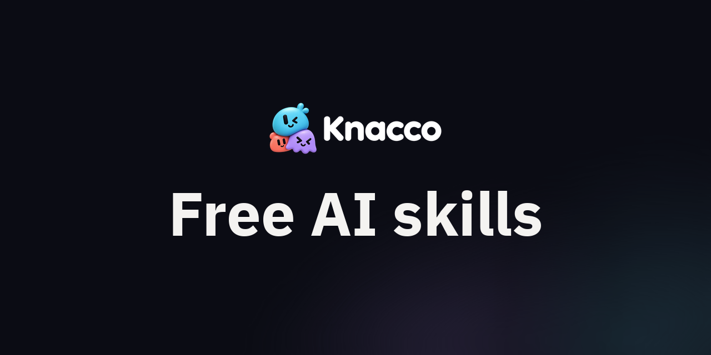
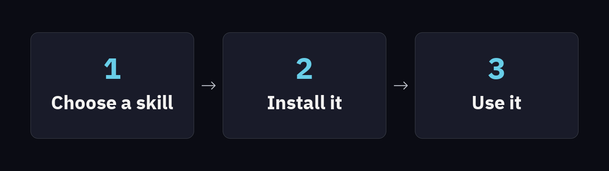

<p align="center">
  
</p>

# Knacco Free Skills

Free AI skills from Knacco, the AI work library: ready to install in Claude Code, Codex and Gemini CLI.

## Skills

| Skill | What it does | Folder |
| --- | --- | --- |
| Brand Guide Builder | Turns existing brand assets into reusable rules and checks new documents against them. | [`kit-brand-guide-builder`](skills/kit-brand-guide-builder) |
| Product Photo & Video Prompts | Writes matching image and motion prompts from one product brief and checks them before you generate. | [`kit-image-video-prompt-pack`](skills/kit-image-video-prompt-pack) |
| Prompt Writing Guide | Builds reusable prompts from four parts and names the weakest part. | [`kit-prompt-writing-system`](skills/kit-prompt-writing-system) |
| Lead Magnet Planner | Ranks free-offer ideas against your paid offer and prepares a build specification. | [`kit-lead-magnet-builder`](skills/kit-lead-magnet-builder) |
| Data Research & Press Kit | Plans a small data study, checks a sample of the records and prepares findings and press materials. | [`kit-data-study-press-pack`](skills/kit-data-study-press-pack) |
| AI Project Memory | Keeps workspace and project decisions in readable memory files and checks them for stale or conflicting records. | [`kit-agent-memory-system`](skills/kit-agent-memory-system) |

## Installation

<p align="center">
  
</p>

Run one command in your project folder. It needs Node.js 22.20 or newer, lists the six skills and asks which to install.

| Tool | Command |
| --- | --- |
| Claude Code | `npx skills add byoverseas/knacco-free-skills --agent claude-code` |
| Codex | `npx skills add byoverseas/knacco-free-skills --agent codex` |
| Gemini CLI | `npx skills add byoverseas/knacco-free-skills --agent gemini-cli` |

Add `--skill kit-brand-guide-builder` to install one skill, or `--global` to install for every project. Restart your tool so it finds the skill.

Claude Code can also install all six as a plugin:

```sh
claude plugin install knacco-free-skills --marketplace byoverseas/knacco-free-skills
```

To install without Node.js, download this repository and copy a skill folder into your tool's skills folder.

| Tool | In one project | For every project |
| --- | --- | --- |
| Claude Code | `.claude/skills/` | `~/.claude/skills/` |
| Codex | `.agents/skills/` | `~/.agents/skills/` |
| Gemini CLI | `.gemini/skills/` | `~/.gemini/skills/` |

The tools inside each skill need Python 3.9 or newer and use the standard library only.

## Example

Product Photo & Video Prompts turns one brief into a still prompt and an animation prompt that describe the same product in the same words.

Ask your AI tool:

```text
Use kit-image-video-prompt-pack. The product is a 320 ml stoneware mug on a pale oak
bench in a pottery studio, lit by a north window, with thin steam rising from the rim.
Write the still prompt and the animation prompt, then check the pair.
```

Or run the tools yourself from the skill folder:

```sh
python3 tools/pair_builder.py --example > brief.json
python3 tools/pair_builder.py brief.json --out ./pair
python3 tools/check_pair.py pair/still.txt pair/motion.txt
```

The checker reports the result before you pay for a render:

```text
PASS  score 100/100  errors 0  warnings 0
```

## More from Knacco

These six skills come from the Knacco library: see [all free products](https://knacco.com/en/categories/free) or visit [knacco.com](https://knacco.com).

## Licence

Free to use, including in paid client work. You may change the skills for your own purposes and keep whatever you make with them. You may not resell them or redistribute them as your own. The full terms are in the [licence](LICENSE).

## Contact

[knacco.com/en/pages/contact](https://knacco.com/en/pages/contact)
