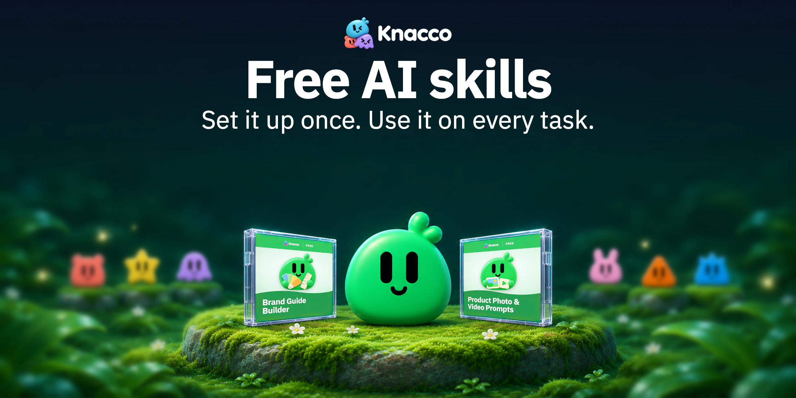
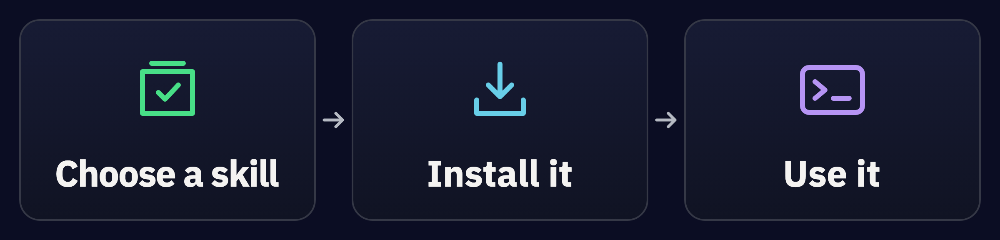
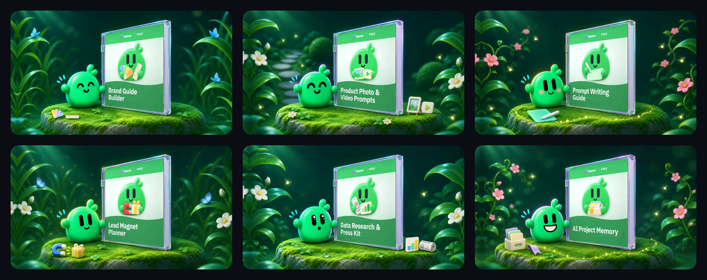

<p align="center">
  
</p>

<p align="center">
  <a href="#installation"></a>
  <a href="#installation"></a>
  <a href="#installation"></a>
  <a href="#installation"></a>
  <a href="#installation"></a>
  <br>
  <a href="#installation"></a>
  <a href="#installation"></a>
  <a href="#installation"></a>
  <a href="#installation"></a>
  <br>
  <a href="#skills"></a>
  <a href="#installation"></a>
  <a href="#installation"></a>
  <a href="LICENSE"></a>
</p>

# Knacco Free Skills

Ready-to-use AI skills, guides and workflows for writing, research and creative work. Your AI gets the steps and the rules, so you stop writing the same instructions again.

## Installation

<p align="center">
  
</p>

Run one command in your project folder. It needs Node.js 22.20 or later.

```sh
npx skills add byoverseas/knacco-free-skills
```

Restart your tool, and the product is ready. The tools inside each product need Python 3.9 or later.

<details>
<summary>More installation options</summary>

**Install for a specific tool**

Add `--agent` followed by the tool name.

| Tool | Name |
| --- | --- |
| Claude Code | `claude-code` |
| Codex | `codex` |
| Google Antigravity | `antigravity` |
| Cursor | `cursor` |
| GitHub Copilot | `github-copilot` |
| OpenCode | `opencode` |
| OpenClaw | `openclaw` |
| Hermes Agent | `hermes-agent` |
| Gemini CLI | `gemini-cli` |

Add `--skill kit-brand-guide-builder` to install one product or `--global` to install for every project.

**Install as a Claude Code plugin**

```sh
claude plugin install knacco-free-skills --marketplace byoverseas/knacco-free-skills
```

**Install manually**

Download the repository and copy a product folder into the skills folder in your project.

| Tool | Skills folder |
| --- | --- |
| Claude Code | `.claude/skills/` |
| Codex, Google Antigravity, Cursor, GitHub Copilot, OpenCode, Gemini CLI | `.agents/skills/` |
| OpenClaw | `skills/` |
| Hermes Agent | `.hermes/skills/` |

</details>

## Skills

<p align="center">
  
</p>

| Product |
| --- |
| **[Brand Guide Builder](skills/kit-brand-guide-builder)** · Skill<br>Turn existing brand assets into reusable rules, separate recorded facts from inferred choices, and check proposed documents against the brand specification. |
| **[Product Photo & Video Prompts](skills/kit-image-video-prompt-pack)** · Skill<br>Write matching image and motion prompts from one product brief, then check the product details before generating the media. |
| **[Prompt Writing Guide](skills/kit-prompt-writing-system)** · Guide<br>Build reusable prompts with clear facts, tasks and output examples, then identify missing or weak parts with local checks. |
| **[Lead Magnet Planner](skills/kit-lead-magnet-builder)** · Workflow<br>Rank free-offer ideas for your audience and paid offer, then prepare a build specification with clear inputs, outputs and success measures. |
| **[Data Research & Press Kit](skills/kit-data-study-press-pack)** · Workflow<br>Plan a focused data study, check a sample of the records, and prepare findings and press materials with a documented method. |
| **[AI Project Memory](skills/kit-agent-memory-system)** · Guide<br>Organize workspace, project and campaign decisions in readable memory files, then check for stale information, conflicting records and missing details. |

## Example

Try [Product Photo & Video Prompts](skills/kit-image-video-prompt-pack) in your AI tool.

```text
Use kit-image-video-prompt-pack.
The product is a stoneware mug on an
oak bench, lit by a north window.
Write a still prompt and a motion
prompt, then check the pair.
```

## Connect your Knacco library

Bring your Knacco library into Claude, Claude Code, ChatGPT, Codex, Cursor, VS Code with GitHub Copilot and Antigravity. Connect once. Then search what you own, open a product's guide and get your files without leaving the conversation.

```sh
claude mcp add --transport http knacco https://knacco.com/api/v1/agent/mcp
```

Every other tool: [knacco.com/en/plugin](https://knacco.com/en/plugin)

## Licence

Free to use, including in paid client work. You may change it for your own purposes and ship whatever you make with it. You may not resell it or redistribute it as your own. The full terms are in the [licence](LICENSE).

[Free products](https://knacco.com/en/free) · [Browse the collection](https://knacco.com/en#collection) · [Contact](https://knacco.com/en/contact)
